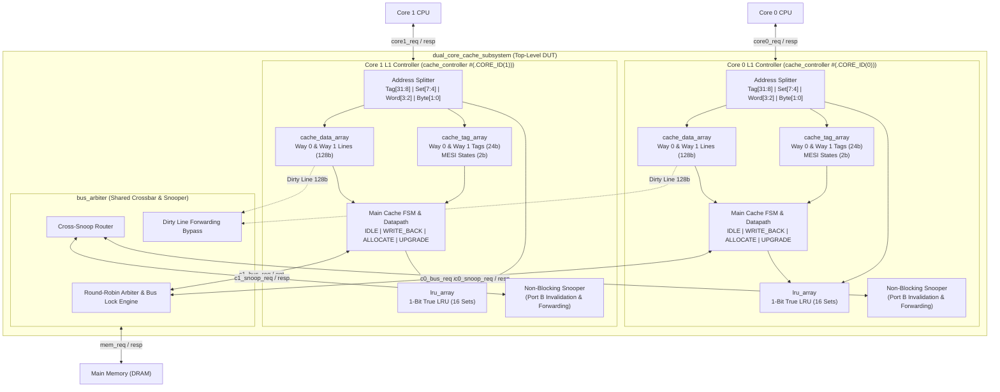

# Dual-Core 2-Way Set-Associative MESI Cache Subsystem

[](https://en.wikipedia.org/wiki/SystemVerilog)
[](https://www.xilinx.com/products/design-tools/vivado.html)
[]()
[](LICENSE)

A synthesizable, high-performance **Dual-Core 2-Way Set-Associative L1 Cache Subsystem** implemented in SystemVerilog. Features hardware-enforced **MESI cache coherence**, non-blocking dual-port snooping, round-robin bus arbitration, true LRU replacement, and dirty line cache-to-cache forwarding.

---

## Key Features & Architectural Specifications

| Parameter | Value | Description |
| :--- | :--- | :--- |
| **Coherence Protocol** | **MESI** | Hardware-managed Modified, Exclusive, Shared, Invalid protocol |
| **Cache Organization** | **2-Way Set-Associative** | 16 sets per core (32 lines total per core) |
| **Line / Block Size** | **16 Bytes (128 bits)** | 4 x 32-bit words per line with byte-enable write masking |
| **Total L1 Capacity** | **512 Bytes / Core** | 1 KB total dual-core L1 subsystem |
| **Hit Latency** | **1 Clock Cycle** | Combinational tag match & SRAM read on Port A |
| **Snooper Architecture** | **Decoupled / Non-Blocking** | Independent Port B snooper invalidates/downgrades without CPU stalls |
| **Replacement Policy** | **1-Bit True LRU** | Strict 2-way LRU tracking bit per cache set |
| **Write Policy** | **Write-Back, Write-Allocate** | Dirty line write-back on eviction; allocation on write miss |
| **Interconnect** | **Cross-Snoop Arbiter** | Fair round-robin arbitration with direct peer dirty line forwarding |

---

## System Architecture

```text
+========================================================================================================+
|                                  TESTBENCH VERIFICATION ENVIRONMENT                                    |
|                                                                                                        |
|   +-------------------------------+                          +-------------------------------+         |
|   |     CPU CORE 0 EMULATOR       |                          |     CPU CORE 1 EMULATOR       |         |
|   +---------------+---------------+                          +---------------+---------------+         |
+===================|==========================================================|=========================+
                    | (core0_req / core0_resp)                                 | (core1_req / core1_resp)
                    v                                                          v
+========================================================================================================+
|                              DESIGN UNDER TEST (dual_core_cache_subsystem.sv)                          |
|                                                                                                        |
|   +------------------------------------+             +------------------------------------+            |
|   |     L1 CACHE CONTROLLER 0          |             |     L1 CACHE CONTROLLER 1          |            |
|   |  - Main FSM (Transactions)         |             |  - Main FSM (Transactions)         |            |
|   |  - Snoop FSM (Coherence)           |             |  - Snoop FSM (Coherence)           |            |
|   |  - Dual-Port Tag SRAM (24b)        |             |  - Dual-Port Tag SRAM (24b)        |            |
|   |  - Dual-Port Data SRAM (128b)      |             |  - Dual-Port Data SRAM (128b)      |            |
|   |  - True LRU Array (1-bit)          |             |  - True LRU Array (1-bit)          |            |
|   +-----------------+------------------+             +-----------------+------------------+            |
|                     |                                                  |                               |
|                     |                  CROSS-SNOOP BUS                 |                               |
|                     +--------------------<=======>---------------------+                               |
|                                         |         |                                                    |
|                                         v         v                                                    |
|                              +------------------------------+                                          |
|                              |      SHARED BUS ARBITER      |                                          |
|                              |       (bus_arbiter.sv)       |                                          |
|                              +--------------+---------------+                                          |
+=============================================|==========================================================+
                                              | (mem_req / mem_resp)
                                              v
+========================================================================================================+
|                                       OFF-CHIP MAIN MEMORY (DRAM)                                      |
|                                      (tb/mem_slave_model.sv)                                           |
+========================================================================================================+
```

---

## RTL Hardware Datapath



---

## Repository Structure

```
Cache_Controller/
├── rtl/                                  # Synthesizable SystemVerilog RTL
│   ├── cache_def.sv                      # Global parameters, MESI enums & bus command definitions
│   ├── cache_tag_array.sv                # Dual-port Tag & MESI state array with parallel hit logic
│   ├── cache_data_array.sv               # Dual-port Data RAM (16 sets x 2 ways x 128-bit lines)
│   ├── lru_array.sv                      # 1-bit True LRU replacement storage & update logic
│   ├── cache_controller.sv               # L1 Cache Controller (Main FSM & Snooping Engine)
│   ├── bus_arbiter.sv                    # Round-robin arbiter with cross-snoop broadcast & forwarding
│   └── dual_core_cache_subsystem.sv      # Top-level dual-core subsystem wrapper
│
├── tb/                                   # Verification Environment
│   ├── tb_dual_core_cache.sv             # Directed self-checking testbench (MESI coherence tests)
│   ├── mem_slave_model.sv                # Behavioral DRAM slave with backdoor write & latency model
│   └── if/
│       └── mem_bus_if.sv                 # Shared memory bus interface definition
│
├── sim/                                  # Simulation Scripts & Logs
│   ├── run_non_uvm_sim.bat               # One-click Vivado XSIM simulation script (Windows)
│   └── xsim.log                          # Simulation execution transcript & pass results
│
├── docs/                                 # Architectural Specifications & Deep-Dives
│   └── CACHE_CONTROLLER_INTERVIEW_PREP_GUIDE.md  # Detailed interview & architectural reference
└── CACHE_CONTROLLER_ARCHITECTURE_REPORT.md       # Full hardware microarchitecture specification
```

---

## Finite State Machines & MESI Coherence

Inside each cache controller, two state machines operate concurrently to prevent pipeline stalls:

### 1. Main Controller FSM (`cache_fsm_state_t`)

| State | Hardware Action | Bus Command Issued | Next State |
| :--- | :--- | :---: | :--- |
| **`FSM_IDLE`** | Evaluates tag match combinationally. Serves hit in 1 cycle. | `BUS_IDLE` | `FSM_IDLE` (Hit)<br>`FSM_UPGRADE` (Write Hit on `S`)<br>`FSM_WRITE_BACK` (Miss + Dirty Victim)<br>`FSM_ALLOCATE` (Miss + Clean Victim) |
| **`FSM_WRITE_BACK`** | Flushes 16-byte dirty victim line to DRAM. | **`BUS_WB`** | `FSM_ALLOCATE` (upon DRAM ack) |
| **`FSM_ALLOCATE`** | Refills 16-byte block from DRAM or dirty peer. Updates SRAM & tag. | **`BUS_RD`** (load)<br>**`BUS_RDX`** (store) | `FSM_IDLE` (upon refill complete) |
| **`FSM_UPGRADE`** | Broadcasts invalidation to peers. Upgrades local line `S` $\rightarrow$ `M`. | **`BUS_UPGR`** | `FSM_IDLE` (upon bus grant) |

### 2. MESI Protocol Transition Matrix (`mesi_state_t`)

| Current State | CPU Read | CPU Write | Peer Snoop Read (`BUS_RD`) | Peer Snoop Write (`BUS_RDX` / `BUS_UPGR`) |
| :---: | :---: | :---: | :---: | :---: |
| **`INVALID` (I)** | Miss: Refill via `BUS_RD`<br>$\rightarrow$ **`E`** (no peer) / **`S`** (peer hit) | Miss: Refill via `BUS_RDX`<br>$\rightarrow$ **`M`** | No Action | No Action |
| **`SHARED` (S)** | Hit (1-cycle):<br>Remains in **`S`** | Hit: Broadcast `BUS_UPGR`<br>$\rightarrow$ **`M`** | Hit: Remains in **`S`** | Invalidate copy:<br>$\rightarrow$ **`I`** |
| **`EXCLUSIVE` (E)** | Hit (1-cycle):<br>Remains in **`E`** | Silent Hit (0 bus traffic):<br>$\rightarrow$ **`M`** | Downgrade copy:<br>$\rightarrow$ **`S`** | Invalidate copy:<br>$\rightarrow$ **`I`** |
| **`MODIFIED` (M)** | Hit (1-cycle):<br>Remains in **`M`** | Silent Hit (0 bus traffic):<br>$\rightarrow$ **`M`** | **Dirty Forwarding** to peer:<br>$\rightarrow$ **`S`** | **Dirty Forwarding**, then invalidate:<br>$\rightarrow$ **`I`** |

---

## Verification Suite & Simulation Results

The testbench [`tb/tb_dual_core_cache.sv`](tb/tb_dual_core_cache.sv) runs 5 comprehensive directed test cases validating single-cycle hits, cold misses, write allocations, and multi-core coherence:

| Test | Scenario | Verified Hardware Behavior | Status |
| :---: | :--- | :--- | :---: |
| **1** | **Core 0 Cold Read Miss** | Line refilled from DRAM into Core 0 cache. State becomes `EXCLUSIVE`. | **PASS** |
| **2** | **Core 0 Read Hit** | Word delivered directly from Data SRAM in 1 clock cycle without bus traffic. | **PASS** |
| **3** | **Core 0 Local Write** | Word written into Data SRAM. Line transitions from `EXCLUSIVE` $\rightarrow$ `MODIFIED`. | **PASS** |
| **4** | **MESI Cross-Snoop Forwarding** | Core 1 reads same address. Core 0 snoops, detects `MODIFIED`, and forwards dirty line directly to Core 1, bypassing stale DRAM! | **PASS** |
| **5** | **Core 1 Read Hit (Shared)** | Core 1 reads word from newly installed line in `SHARED` state in 1 clock cycle. | **PASS** |

### Vivado XSIM Simulation Transcript

```text
==================================================================
   STARTING NON-UVM DUAL-CORE CACHE VERIFICATION TESTBENCH        
==================================================================

--- Test 1: Core 0 Cold Read Miss from DRAM ---
[PASS] Core 0 Read Miss (Word 0): Got 0xaaaa5555 (Expected 0xaaaa5555)

--- Test 2: Core 0 Read Hit on Installed Line ---
[PASS] Core 0 Read Hit (Word 1): Got 0x12345678 (Expected 0x12345678)

--- Test 3: Core 0 Local Write to Word 0 ---
[PASS] Core 0 Read after Write: Got 0xdead9999 (Expected 0xdead9999)

--- Test 4: MESI Cross-Snoop Dirty Forwarding (Core 1 reads Core 0's modified data) ---
[PASS] Core 1 Snoop Hit on Dirty Line: Got 0xdead9999 (Expected 0xdead9999)

--- Test 5: Core 1 Read Hit (Now in SHARED state) ---
[PASS] Core 1 Read Hit (Word 1): Got 0x12345678 (Expected 0x12345678)

==================================================================
   VERIFICATION SUMMARY: TOTAL=5 | PASSED=5 | FAILED=0
==================================================================
>>> ALL TESTS PASSED SUCCESSFULLY! <<<
```

---

## How to Run Simulation

### Prerequisites
* **AMD / Xilinx Vivado** (v2020.1 or newer, e.g. Vivado 2024.1)

### Quick Run (Windows Batch File)
Open a terminal in the `sim/` directory and run:

```cmd
cd sim
run_non_uvm_sim.bat
```

### Manual Vivado CLI Commands
```powershell
cd sim

# 1. Compile SystemVerilog RTL and Testbench
xvlog -sv -i ../rtl ../rtl/cache_def.sv ../rtl/cache_tag_array.sv ../rtl/cache_data_array.sv ../rtl/lru_array.sv ../rtl/cache_controller.sv ../rtl/bus_arbiter.sv ../rtl/dual_core_cache_subsystem.sv ../tb/mem_slave_model.sv ../tb/tb_dual_core_cache.sv

# 2. Elaborate design snapshot
xelab -timescale 1ns/1ps -top tb_dual_core_cache -snapshot tb_dual_core_cache_sim -debug typical

# 3. Run batch simulation
xsim tb_dual_core_cache_sim -R
```

---

## Documentation Links
* [Full Hardware Architecture Specification](CACHE_CONTROLLER_ARCHITECTURE_REPORT.md) — 400+ line technical report detailing datapath schematics, arbitration protocols, and timing diagrams.
* [Interview Preparation & Design Tradeoffs Guide](docs/CACHE_CONTROLLER_INTERVIEW_PREP_GUIDE.md) — Common interview questions, race condition analysis, and coherence trade-offs.
