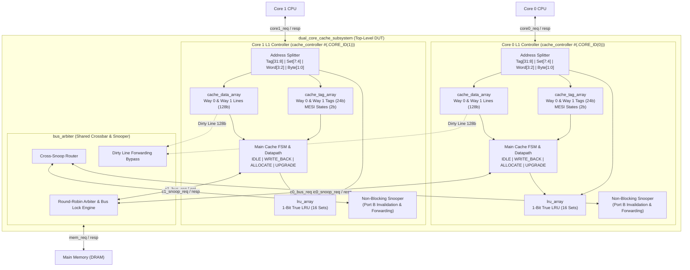

# Dual-Core 2-Way Set-Associative MESI Cache Subsystem

[](https://en.wikipedia.org/wiki/SystemVerilog)
[](https://www.xilinx.com/products/design-tools/vivado.html)
[]()
[-brightgreen.svg)]()
[-brightgreen.svg)]()

A synthesizable, production-grade **Dual-Core 2-Way Set-Associative L1 Cache Subsystem** implemented in SystemVerilog. Features hardware-enforced **MESI cache coherence**, non-blocking dual-port snooping, and a fully verified golden scoreboard-driven testbench.

---

## Key Features & Architectural Specifications

| Parameter | Value | Description |
| :--- | :--- | :--- |
| **Coherence Protocol** | **MESI** | Hardware-managed Modified, Exclusive, Shared, Invalid protocol |
| **Cache Organization** | **2-Way Set-Associative** | 16 sets per core (32 lines total per core) |
| **Line / Block Size** | **16 Bytes (128 bits)** | 4 x 32-bit words per line with byte-enable write masking |
| **Total L1 Capacity** | **512 Bytes / Core** | 1 KB total dual-core L1 subsystem |
| **Hit Latency** | **1 Clock Cycle** | Combinational tag match & SRAM read on Port A |
| **Snooper Architecture** | **Decoupled / Non-Blocking** | Independent Port B snooper invalidates/downgrades without CPU stalls |
| **Replacement Policy** | **1-Bit True LRU** | Strict 2-way LRU tracking bit per cache set |
| **Write Policy** | **Write-Back, Write-Allocate** | Dirty line write-back on eviction; allocation on write miss |
| **Interconnect** | **Cross-Snoop Arbiter** | Fair round-robin arbitration with direct peer dirty line forwarding |
| **Functional Coverage** | **100.00%** | Full coverage of states, word offsets, byte enables, and bus commands |
| **Formal Assertions** | **SVA (70+ Checkers)** | SWMR coherence invariants, arbiter mutual exclusion, strobe pulses |
| **Self-Checking Model** | **Golden Scoreboard** | Real-time associative array reference tracking partial byte updates |

---

## Verification Architecture (3-Tier Assurance)

```text
+========================================================================================================+
|                                    3-TIER VERIFICATION ARCHITECTURE                                    |
|                                                                                                        |
|   +------------------------------------------------------------------------------------------------+   |
|   |                       Tier 3: Constrained-Random Multi-Core Stress Engine                      |   |
|   |   - cache_trans Class with weighted distributions (Full-word, halfword, byte enables)          |   |
|   |   - Phase 16A: Concurrent parallel traffic via fork...join (80 transactions)                   |   |
|   |   - Phase 16B: Shared-line ping-pong coherency stress (40 transactions)                        |   |
|   +-----------------------------------------------+------------------------------------------------+   |
|                                                   |                                                    |
|                                                   v Drives transactions                                |
|   +------------------------------------------------------------------------------------------------+   |
|   |                         Tier 2: Golden Shared-Memory Scoreboard                                |   |
|   |   - Word-aligned associative memory model: logic [31:0] golden_mem [logic [31:0]]               |   |
|   |   - Dynamic byte-mask write merging (byte_en[3:0]) & DRAM baseline synchronization             |   |
|   |   - Real-time read verification (90 checks passed, 0 mismatches)                               |   |
|   +-----------------------------------------------+------------------------------------------------+   |
|                                                   |                                                    |
|                                                   v Monitors transactions                              |
|   +------------------------------------------------------------------------------------------------+   |
|   |                 Design Under Test (DUT) & DRAM Behavioral Memory Model                         |   |
|   +-----------------------------------------------+------------------------------------------------+   |
|                                                   ^                                                    |
|                                                   | Invariant validation                               |
|   +-----------------------------------------------+------------------------------------------------+   |
|   |                         Tier 1: SystemVerilog Assertions (SVA)                                 |   |
|   |   - Global Single-Writer / Multiple-Reader (SWMR) Invariant across all 16 sets (64 checkers)   |   |
|   |   - Snoop Invalidation on write broadcast (BUS_RDX / BUS_UPGR)                                 |   |
|   |   - Snoop Dirty Downgrade on read broadcast (BUS_RD)                                           |   |
|   |   - Arbiter Mutual Exclusion & No Phantom Grants                                               |   |
|   |   - CPU / DRAM 1-Cycle Handshake Pulse Strobes & Read Hit Silence                              |   |
|   +------------------------------------------------------------------------------------------------+   |
+========================================================================================================+
```

---

## System Architecture

```text
+========================================================================================================+
|                                  TESTBENCH VERIFICATION ENVIRONMENT                                    |
|                                                                                                        |
|   +-------------------------------+                          +-------------------------------+         |
|   |     CPU CORE 0 EMULATOR       |                          |     CPU CORE 1 EMULATOR       |         |
|   +---------------+---------------+                          +---------------+---------------+         |
+===================|==========================================================|=========================+
                    | (core0_req / core0_resp)                                 | (core1_req / core1_resp)
                    v                                                          v
+========================================================================================================+
|                              DESIGN UNDER TEST (dual_core_cache_subsystem.sv)                          |
|                                                                                                        |
|   +------------------------------------+             +------------------------------------+            |
|   |     L1 CACHE CONTROLLER 0          |             |     L1 CACHE CONTROLLER 1          |            |
|   |  - Main FSM (Transactions)         |             |  - Main FSM (Transactions)         |            |
|   |  - Snoop FSM (Coherence)           |             |  - Snoop FSM (Coherence)           |            |
|   |  - Dual-Port Tag SRAM (24b)        |             |  - Dual-Port Tag SRAM (24b)        |            |
|   |  - Dual-Port Data SRAM (128b)      |             |  - Dual-Port Data SRAM (128b)      |            |
|   |  - True LRU Array (1-bit)          |             |  - True LRU Array (1-bit)          |            |
|   +-----------------+------------------+             +-----------------+------------------+            |
|                     |                                                  |                               |
|                     |                  CROSS-SNOOP BUS                 |                               |
|                     +--------------------<=======>---------------------+                               |
|                                         |         |                                                    |
|                                         v         v                                                    |
|                              +------------------------------+                                          |
|                              |      SHARED BUS ARBITER      |                                          |
|                              |       (bus_arbiter.sv)       |                                          |
|                              +--------------+---------------+                                          |
+=============================================|==========================================================+
                                              | (mem_req / mem_resp)
                                              v
+========================================================================================================+
|                                       OFF-CHIP MAIN MEMORY (DRAM)                                      |
|                                      (tb/mem_slave_model.sv)                                           |
+========================================================================================================+
```

---

## RTL Hardware Datapath



---

## Repository Structure

```
Cache_Controller/
├── rtl/                                  # Synthesizable SystemVerilog RTL
│   ├── cache_def.sv                      # Global parameters, MESI enums & bus command definitions
│   ├── cache_tag_array.sv                # Dual-port Tag & MESI state array with parallel hit logic
│   ├── cache_data_array.sv               # Dual-port Data RAM (16 sets x 2 ways x 128-bit lines)
│   ├── lru_array.sv                      # 1-bit True LRU replacement storage & update logic
│   ├── cache_controller.sv               # L1 Cache Controller (Main FSM & Snooping Engine)
│   ├── bus_arbiter.sv                    # Round-robin arbiter with cross-snoop broadcast & forwarding
│   └── dual_core_cache_subsystem.sv      # Top-level dual-core subsystem wrapper
│
├── tb/                                   # Verification Environment
│   ├── tb_dual_core_cache.sv             # Testbench (SVA, Scoreboard, Random Multi-Core Engine)
│   └── mem_slave_model.sv                # Behavioral DRAM slave with backdoor write & latency model
│
├── sim/                                  # Simulation & Coverage Automation
│   ├── run_coverage.bat                  # Vivado batch script (Compilation + Sim + XCRG Coverage)
│   ├── run_non_uvm_sim.bat               # Fast CLI simulation script
│   ├── cov/                              # XSIM code & functional coverage database
│   └── coverage_report/                  # HTML Code & Functional Coverage reports
│       ├── functionalCoverageReport/     # Interactive functional coverage dashboard
│       └── codeCoverageReport/           # Line, branch, condition, toggle reports
│
└── CACHE_CONTROLLER_ARCHITECTURE_REPORT.md       # Full hardware microarchitecture specification
```

---

## Finite State Machines & MESI Coherence

Inside each cache controller, two state machines operate concurrently to prevent pipeline stalls:

### 1. Main Controller FSM (`cache_fsm_state_t`)

| State | Hardware Action | Bus Command Issued | Next State |
| :--- | :--- | :---: | :--- |
| **`FSM_IDLE`** | Evaluates tag match combinationally. Serves hit in 1 cycle. | `BUS_IDLE` | `FSM_IDLE` (Hit)<br>`FSM_UPGRADE` (Write Hit on `S`)<br>`FSM_WRITE_BACK` (Miss + Dirty Victim)<br>`FSM_ALL[...]` |
| **`FSM_WRITE_BACK`** | Flushes 16-byte dirty victim line to DRAM. | **`BUS_WB`** | `FSM_ALLOCATE` (upon DRAM ack) |
| **`FSM_ALLOCATE`** | Refills 16-byte block from DRAM or dirty peer. Updates SRAM & tag. | **`BUS_RD`** (load)<br>**`BUS_RDX`** (store) | `FSM_IDLE` (upon refill complete) |
| **`FSM_UPGRADE`** | Broadcasts invalidation to peers. Upgrades local line `S` $\rightarrow$ `M`. | **`BUS_UPGR`** | `FSM_IDLE` (upon bus grant) |

### 2. MESI Protocol Transition Matrix (`mesi_state_t`)

| Current State | CPU Read | CPU Write | Peer Snoop Read (`BUS_RD`) | Peer Snoop Write (`BUS_RDX` / `BUS_UPGR`) |
| :---: | :---: | :---: | :---: | :---: |
| **`INVALID` (I)** | Miss: Refill via `BUS_RD`<br>$\rightarrow$ **`E`** (no peer) / **`S`** (peer hit) | Miss: Refill via `BUS_RDX`<br>$\rightarrow$ **`M`** | No Action | No Action |
| **`SHARED` (S)** | Hit (1-cycle):<br>Remains in **`S`** | Hit: Broadcast `BUS_UPGR`<br>$\rightarrow$ **`M`** | Hit: Remains in **`S`** | Invalidate copy:<br>$\rightarrow$ **`I`** |
| **`EXCLUSIVE` (E)** | Hit (1-cycle):<br>Remains in **`E`** | Silent Hit (0 bus traffic):<br>$\rightarrow$ **`M`** | Downgrade copy:<br>$\rightarrow$ **`S`** | Invalidate copy:<br>$\rightarrow$ **`I`** |
| **`MODIFIED` (M)** | Hit (1-cycle):<br>Remains in **`M`** | Silent Hit (0 bus traffic):<br>$\rightarrow$ **`M`** | **Dirty Forwarding** to peer:<br>$\rightarrow$ **`S`** | **Dirty Forwarding**, then invalidate:<br>$\rightarrow$ **`I`** |

---

## Verification Test Suite & Results

The testbench [`tb/tb_dual_core_cache.sv`](tb/tb_dual_core_cache.sv) implements 16 comprehensive directed and randomized test scenarios:

| Test | Scenario | Verified Hardware Behavior | SVA & Scoreboard Checks | Status |
| :---: | :--- | :--- | :---: | :---: |
| **1** | **Core 0 Cold Read Miss** | Line refilled from DRAM into Core 0 cache. State becomes `EXCLUSIVE`. | Scoreboard Match | **PASS** |
| **2** | **Core 0 Read Hit** | Word delivered directly from Data SRAM in 1 clock cycle without bus traffic. | Scoreboard Match | **PASS** |
| **3** | **Core 0 Local Write** | Word written into Data SRAM. Line transitions from `EXCLUSIVE` $\rightarrow$ `MODIFIED`. | Scoreboard Match | **PASS** |
| **4** | **MESI Cross-Snoop Forwarding** | Core 1 reads same address. Core 0 snoops, detects `MODIFIED`, and forwards dirty line directly to Core 1, bypassing stale DRAM. | Scoreboard Match | **PASS** |
| **5** | **Core 1 Read Hit (Shared)** | Core 1 reads word from newly installed line in `SHARED` state in 1 clock cycle. | Scoreboard Match | **PASS** |
| **6** | **Core 0 Write Hit on Shared** | Broadcasts `BUS_UPGR`, invalidates Core 1 (`S` $\rightarrow$ `I`), upgrades Core 0 (`S` $\rightarrow$ `M`). | Scoreboard Match | **PASS** |
| **7** | **Core 1 Write Miss (Allocation)** | Issues `BUS_RDX` to DRAM, installs line in `MODIFIED` state. | Scoreboard Match | **PASS** |
| **8** | **All Word Offsets (0, 1, 2, 3)** | Read/Write operations on all word offsets (`addr[3:2]`) across both cores. | 5 Scoreboard Checks | **PASS** |
| **9** | **Sub-Word Byte Enables** | Tests halfword (`4'b0011`, `4'b1100`) and individual byte (`4'b0001`..`4'b1000`) write merging. | 3 Scoreboard Checks | **PASS** |
| **10** | **Core 0 Conflict Eviction & WB** | 2-Way set conflict forces LRU victim eviction; flushes dirty line to DRAM via `BUS_WB`. | 2 Scoreboard Checks | **PASS** |
| **11** | **Core 0 Word 1 Store Cross** | Verifies Store cross-coverage with Word 1 offset. | Scoreboard Match | **PASS** |
| **12** | **Core 1 Cold Read Miss** | Installs clean line in `EXCLUSIVE` state. | Scoreboard Match | **PASS** |
| **13** | **Core 0 Reads Core 1 Line** | Triggers snoop downgrade in Core 1 (`E` $\rightarrow$ `S`), installs in Core 0 as `SHARED`. | Scoreboard Match | **PASS** |
| **14** | **Core 1 Upgrade Write** | Broadcasts `BUS_UPGR`, invalidates Core 0, transitions Core 1 to `MODIFIED`. | Scoreboard Match | **PASS** |
| **15** | **Core 1 Conflict Eviction & WB** | 2-Way set conflict forces dirty eviction to DRAM via `BUS_WB`. | Scoreboard Match | **PASS** |
| **16A** | **Concurrent Multi-Core Parallel Stress** | `fork...join` concurrent execution of 80 randomized transactions across Core 0 and Core 1. Stresses arbiter contention, parallel refills, and shared-bus scheduling. | 0 errors | **PASS** |
| **16B** | **Shared-Line Coherence Ping-Pong Stress** | 40 randomized reads/writes on shared lines (`0x5000`, `0x6000`). Stresses cross-snoops, dirty line forwarding, upgrades, and invalidations. | 0 errors | **PASS** |

### Vivado XSIM Simulation Transcript

```text
==================================================================
   STARTING NON-UVM DUAL-CORE CACHE VERIFICATION TESTBENCH        
==================================================================

... [Tests 1 to 15 Passed Cleanly] ...

==================================================================
   TEST 16: CONSTRAINED-RANDOM MULTI-CORE STRESS TEST (STEP 3)    
==================================================================

--- Test 16A: Concurrent Multi-Core Parallel Traffic (Arbiter & Cache Conflicts) ---
[PASS] Test 16A Completed: 80 Parallel Transactions processed with 0 SVA & 0 Scoreboard errors.

--- Test 16B: Multi-Core Shared-Line Coherency Stress (MESI Invalidation/Forwarding) ---
[PASS] Test 16B Completed: 40 Shared-Line Coherence Transactions verified with 0 errors.

==================================================================
   DIRECTED TESTS:       TOTAL=20 | PASSED=20 | FAILED=0
   GOLDEN SCOREBOARD:    CHECKS=90 | PASSED=90 | FAILED=0
   FUNCTIONAL COVERAGE:  100.00%
   SVA ASSERTIONS:       0 VIOLATIONS ACROSS 6,645 CYCLES
==================================================================
>>> ALL TESTS & SCOREBOARD CHECKS PASSED WITH 0 ERRORS! <<<
```

---

## How to Run Simulation & Generate Coverage Reports

### Prerequisites
* **AMD / Xilinx Vivado** (v2020.1 or newer, e.g. Vivado 2024.1) installed with `xvlog`, `xelab`, `xsim`, and `xcrg` in your system `PATH`.

### One-Click Automated Coverage Run (Windows)
Open a terminal in the `sim/` directory and run:

```cmd
cd sim
run_coverage.bat
```

This automated batch script will:
1. Compile all RTL and testbench files with `xvlog -sv`.
2. Elaborate the design with full code coverage instrumentation (`xelab -cc_type sbct`).
3. Run the simulation snapshot and capture the coverage database (`xsim -cov_db_name cache_cov`).
4. Generate interactive HTML reports using `xcrg`.

### Viewing Coverage Reports
Once the script completes, open the generated HTML dashboards in any web browser:
- **Functional Coverage Dashboard:** `sim/coverage_report/functionalCoverageReport/dashboard.html`
- **Code Coverage Dashboard:** `sim/coverage_report/codeCoverageReport/index.html`

---

## Documentation Links
* [Full Hardware Architecture Specification](CACHE_CONTROLLER_ARCHITECTURE_REPORT.md) — 400+ line technical report detailing datapath schematics, arbitration protocols, and timing diagrams.
