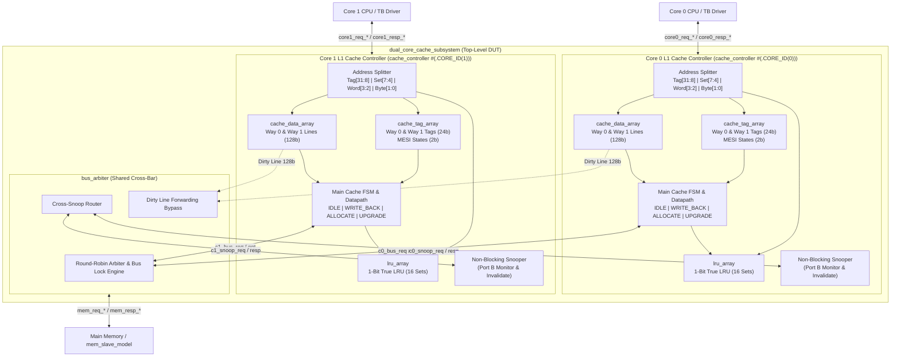

# Dual-Core 2-Way Set-Associative MESI Cache Subsystem & Verification

## Project Overview
This project contains a synthesizable, high-performance **Dual-Core 2-Way Set-Associative L1 Cache Subsystem with MESI Coherence** implemented in SystemVerilog, supporting AMD/Xilinx Vivado synthesis and both non-UVM directed verification and UVM testbench architectures.

---

## System & Verification Block Diagram

```text
+========================================================================================================+
|                                    VERIFICATION ENVIRONMENT (TESTBENCH)                                |
|                                                                                                        |
|   +-------------------------------+                          +-------------------------------+         |
|   |   TESTBENCH CPU AGENT 0       |                          |   TESTBENCH CPU AGENT 1       |         |
|   |  (Emulates RISC-V/ARM Core 0) |                          |  (Emulates RISC-V/ARM Core 1) |         |
|   +---------------+---------------+                          +---------------+---------------+         |
+===================|==========================================================|=========================+
                    | (core0 CPU Interface)                                    | (core1 CPU Interface)   
                    v                                                          v                         
+========================================================================================================+
|                   DESIGN UNDER TEST (RTL: dual_core_cache_subsystem.sv)                                |
|                                                                                                        |
|   +------------------------------------+             +------------------------------------+            |
|   |     L1 CACHE CONTROLLER 0          |             |     L1 CACHE CONTROLLER 1          |            |
|   |    (cache_controller.sv)           |             |    (cache_controller.sv)           |            |
|   |  - State Machine (MESI)            |             |  - State Machine (MESI)            |            |
|   |  - Hit/Miss Comparators            |             |  - Hit/Miss Comparators            |            |
|   |  - Snooping Logic Engine           |             |  - Snooping Logic Engine           |            |
|   |                                    |             |                                    |            |
|   |   +----------------------------+   |             |   +----------------------------+   |            |
|   |   |        CACHE SRAMS         |   |             |   |        CACHE SRAMS         |   |            |
|   |   |  - Tag Array (768 bits)    |   |             |   |  - Tag Array (768 bits)    |   |            |
|   |   |  - Data Array (512 Bytes)  |   |             |   |  - Data Array (512 Bytes)  |   |            |
|   |   |  - LRU Array (16 bits)     |   |             |   |  - LRU Array (16 bits)     |   |            |
|   |   +----------------------------+   |             |   +----------------------------+   |            |
|   +-----------------+------------------+             +-----------------+------------------+            |
|                     |                                                  |                               |
|                     |                  CROSS-SNOOP BUS                 |                               |
|                     +--------------------<=======>---------------------+                               |
|                                         |         |                                                    |
|                                         v         v                                                    |
|                              +------------------------------+                                          |
|                              |      SHARED BUS ARBITER      |                                          |
|                              |       (bus_arbiter.sv)       |                                          |
|                              +--------------+---------------+                                          |
+=============================================|==========================================================+
                                              | (mem_bus_if: mem_req / mem_resp)
                                              v
+========================================================================================================+
|                                    VERIFICATION ENVIRONMENT (TESTBENCH)                                |
|                                                                                                        |
|                               +----------------------------+                                           |
|                               |     REACTIVE MEMORY SLAVE  |                                           |
|                               |    (Emulates Off-Chip DRAM)|                                           |
|                               +----------------------------+                                           |
+========================================================================================================+
```

---

## Detailed RTL Hardware Block Diagram



---

## Directory Structure

```
Cache_Controller/
├── rtl/                        # Synthesizable SystemVerilog RTL
│   ├── cache_def.sv            # Architectural constants, MESI enums, bus commands
│   ├── cache_tag_array.sv      # Dual-port Tag & MESI state array with parallel hit logic
│   ├── cache_data_array.sv     # Dual-port Data RAM (16 sets x 2 ways x 128-bit lines)
│   ├── lru_array.sv            # 1-bit True LRU replacement logic per set
│   ├── cache_controller.sv     # L1 Cache Controller FSM (hits, misses, refills, snooping)
│   ├── bus_arbiter.sv          # Shared bus arbiter with cross-snoop broadcast & forwarding
│   └── dual_core_cache_subsystem.sv # Top-level dual-core subsystem wrapper
│
├── tb/                         # Verification Environment
│   ├── mem_slave_model.sv      # Behavioral non-UVM DRAM slave model with latency simulation
│   ├── tb_dual_core_cache.sv   # Non-UVM directed testbench covering hits, misses & MESI
│   ├── if/                     # SystemVerilog Interfaces
│   │   ├── mem_bus_if.sv       # Main Memory / Shared Interconnect Interface
│   │   ├── cpu_if.sv           # CPU Core Request/Response Interface (UVM)
│   │   └── snoop_if.sv         # Peer Core Snoop Interface (UVM)
│   └── cpu_agent/              # UVM CPU Master Agent (Generates Read/Write transactions)
│
├── sim/                        # Simulation Scripts
│   ├── run_non_uvm_sim.bat     # One-click Vivado XSIM runner for non-UVM testbench
│   ├── run_xsim.bat            # Vivado XSIM UVM Simulation Runner (Windows)
│   ├── run_xsim.sh             # Vivado XSIM UVM Simulation Runner (Linux)
│   └── xsim_gui.tcl            # Waveform and debug TCL script
│
├── synth/                      # Vivado FPGA Synthesis & Implementation Scripts
│   ├── synth.tcl               # Batch synthesis script for Vivado
│   └── constraints.xdc         # Clock & timing constraints file
│
└── docs/                       # Architecture Specs & Verification Reports
    ├── CACHE_CONTROLLER_ARCHITECTURE_REPORT.md
    └── MESI_CACHE_ARCHITECTURE.md
```

---

## Architectural Parameters

| Parameter | Value | Description |
| :--- | :--- | :--- |
| `ADDR_WIDTH` | 32 | 32-bit physical byte address space |
| `DATA_WIDTH` | 32 | 32-bit CPU word width |
| `LINE_WIDTH` | 128 | 16 Bytes (128 bits = 4 words) cache line width |
| `NUM_WAYS` | 2 | 2-Way Set-Associative |
| `NUM_SETS` | 16 | 16 Sets per core ($512\text{B} / (16\text{B} \times 2) = 16$) |
| `TOTAL_SIZE` | 512 Bytes | 512 Bytes per core (1 KB total L1 subsystem) |
| `COHERENCE` | MESI | Modified (M), Exclusive (E), Shared (S), Invalid (I) |
| `REPLACEMENT` | True LRU | 1-bit True LRU binary pointer per set |
| `WRITE_POLICY`| Write-Back | Write-Allocate on write miss, dirty line write-back on eviction |

---

## Cache Controller Internal Architecture (4 Key Sub-Units)

Inside each `cache_controller.sv`, the design is organized into 4 distinct functional units:
1. **Main Control Unit (Main FSM):** Manages local CPU transactions, detects hits/misses, coordinates line refills, drives `cpu_ready`, and is the **sole issuer of bus commands (`bus_req_cmd`)**.
2. **Snoop Control Unit (Concurrent Snooper):** Independent background engine monitoring peer transactions via Port B, enforcing MESI coherence and driving `snoop_resp_dirty` / forwarding dirty lines.
3. **Datapath Unit:** Address bit-slicer, CPU request freeze registers, 2:1 128-bit Way Select MUX, 4:1 32-bit Word Select MUX, and write-merge byte-enable masking logic.
4. **Cache Storage Unit (SRAM Arrays):** Three dedicated physical SRAM modules (`cache_tag_array`, `cache_data_array`, `lru_array`).

---

## Bus Commands & Snooping Operations (`bus_cmd_t`)

### Who Issues Bus Commands?
All external bus commands on `bus_req_cmd` are **issued exclusively by the Main Control Unit (Main FSM)** of the initiating cache controller. The commands flow into the **Bus Arbiter**, which simultaneously cross-routes them to the peer's Snoop Unit and to Main Memory:

```text
[ Initiating Cache Controller ]
  (Main Control Unit / FSM)
             |
             | (1. Issues bus_req_cmd)
             v
   +====================+
   | SHARED BUS ARBITER |
   +====================+
        |            |
        | (2a)       | (2b)
        v            v
  [ Peer Snoop Unit ]  [ Main Memory (DRAM) ]
  (core_snoop_req_cmd)      (mem_req_cmd)
```

| Bus Command | Issued By (FSM State) | Trigger Condition | Hardware Action (How It Operates) | Peer Snooper Action |
| :--- | :--- | :--- | :--- | :--- |
| **`BUS_IDLE`** (`3'b000`) | **`FSM_IDLE`** | No active bus transactions | Bus lines idle; no memory or snoop operations | Idle (no tag lookup) |
| **`BUS_RD`** (`3'b001`) | **`FSM_ALLOCATE`** | CPU Read Miss | Fetches 16B block from DRAM / dirty peer | Peers in `M`/`E` downgrade to `S` (dirty peer supplies line) |
| **`BUS_RDX`** (`3'b010`) | **`FSM_ALLOCATE`** | CPU Write Miss | Fetches 16B block and invalidates all peers | All peers invalidate (`M`/`E`/`S` $\rightarrow$ `I`) |
| **`BUS_UPGR`** (`3'b011`) | **`FSM_UPGRADE`** | CPU Write Hit on `S` | Broadcasts invalidate signal (no data transfer) | Peers in `S` invalidate $\rightarrow$ `I` |
| **`BUS_WB`** (`3'b100`) | **`FSM_WRITE_BACK`**| Eviction of dirty (`M`) line | Flushes 16B dirty block to DRAM before refill | Ignored by peers (DRAM write) |

---

## CPU Miss Handling & Memory Hierarchy Flow

1. **CPU/Cache Isolation:** The CPU **never accesses Main Memory directly**. On a read miss, the CPU stalls while the Cache Controller fetches the 16-byte block from DRAM, stores it into cache SRAM, and delivers the requested 32-bit word over `cpu_resp_rdata`.
2. **Bus Command Progression on Miss:**
   * **Clean Victim (Invalid/Shared/Exclusive):** 
     $$\text{CPU Miss} \longrightarrow \mathbf{FSM\_ALLOCATE}\ (\text{Bus: }\mathbf{BUS\_RD}\text{ or }\mathbf{BUS\_RDX}) \longrightarrow \text{Done}$$
   * **Dirty Victim (Modified):** Two-step sequence:
     $$\text{CPU Miss} \longrightarrow \mathbf{FSM\_WRITE\_BACK}\ (\text{Bus: }\mathbf{BUS\_WB}) \longrightarrow \mathbf{FSM\_ALLOCATE}\ (\text{Bus: }\mathbf{BUS\_RD}\text{ or }\mathbf{BUS\_RDX}) \longrightarrow \text{Done}$$

---

## Finite State Machines (FSM Architecture & State Tables)

Inside `cache_controller.sv`, two state machines run concurrently in hardware:
1. **The Main Controller FSM** (Section 5: Transaction Life-Cycle)
2. **The Snooping Coherence FSM** (Section 4: MESI Protocol Engine)

### Why Two FSMs? (Decoupled / Non-Blocking Snooping)
In multi-core caching, decoupling the local CPU controller from the external snooper ensures maximum performance:
* **FSM 1 (Local CPU):** Services CPU load/store instructions on **Port A** of the Tag/Data arrays, delivering fast **1-cycle hits**.
* **FSM 2 (Snooper):** Simultaneously listens to external transactions on the shared bus via **Port B**. It can downgrade or invalidate cache lines in the background **without stalling the local CPU pipeline**.

---

### 1. Main Controller FSM (`cache_fsm_state_t`)

| State | Entry Condition (Trigger) | Hardware Actions in this State | Bus Command | CPU Status | Next State Transition |
| :--- | :--- | :--- | :---: | :---: | :--- |
| **`FSM_IDLE`** | Reset OR previous transaction finished | • Checks tag match combinationally.<br>• On **Read Hit**: Serves word in 1 cycle.<br>• On **Write Hit (`M`/`E`)**: Updates word in SRAM in 1 cycle. | `BUS_IDLE` | **RUNNING** (`ready=1` on hit) | $\rightarrow$ **`FSM_IDLE`** (on hit)<br>$\rightarrow$ **`FSM_UPGRADE`** (write hit on `S`)<br>$\rightarrow$ **`FSM_WRITE_BACK`** (miss with dirty victim)<br>$\rightarrow$ **`FSM_ALLOCATE`** (miss with clean victim) |
| **`FSM_WRITE_BACK`** | Cache Miss AND victim way is **`MODIFIED`** | • Requests memory bus (`bus_req_valid=1`).<br>• Transmits 16-byte dirty victim line to DRAM.<br>• Latches CPU request address & data. | **`BUS_WB`** | **STALLED** (`ready=0`) | $\rightarrow$ **`FSM_ALLOCATE`** (when `bus_req_gnt && mem_resp_valid`) |
| **`FSM_ALLOCATE`** | Cache Miss with clean victim OR following `FSM_WRITE_BACK` | • Requests 16-byte line from DRAM/peer.<br>• Receives 128-bit line.<br>• Installs line into Data SRAM.<br>• Updates Tag SRAM & MESI state.<br>• Merges write word (if store) or routes word to CPU (if load). | **`BUS_RD`** (load)<br>**`BUS_RDX`** (store) | **STALLED** $\rightarrow$ **UN-STALLED** (`ready=1` on finish) | $\rightarrow$ **`FSM_IDLE`** (when `bus_req_gnt && mem_resp_valid`) |
| **`FSM_UPGRADE`** | CPU Write Hit on a line in **`SHARED` (`S`)** state | • Requests bus to broadcast invalidation.<br>• Peer core snoops and drops its copy to `INVALID`.<br>• Upgrades local line state from `S` $\rightarrow$ `M`.<br>• Writes the CPU word into Data SRAM. | **`BUS_UPGR`** | **STALLED** $\rightarrow$ **UN-STALLED** (`ready=1` on finish) | $\rightarrow$ **`FSM_IDLE`** (when `bus_req_gnt`) |

#### Detailed State Responsibilities:
* **`FSM_IDLE`:** Default operational state. Combinationally extracts `active_tag`, `active_index`, and `active_word_offset`. If `cache_hit == 1`, it immediately serves loads/stores in 1 clock cycle. If a miss or upgrade occurs, it latches request parameters, pulls `cpu_ready = 0`, and branches to the appropriate service state.
* **`FSM_WRITE_BACK`:** Executes the first half of a dirty line eviction. Transmits the 16-byte line buffered in `victim_data_q` back to Main Memory. Holds the bus lock until DRAM acknowledges reception (`mem_resp_valid = 1`).
* **`FSM_ALLOCATE`:** Refills the missing 16-byte block from Main Memory (or from a dirty peer). Once granted and received, it writes the line into Data SRAM, programs the new tag into Tag SRAM, updates the LRU bits, provides the requested word to the CPU, and asserts `cpu_ready = 1` to resume CPU execution.
* **`FSM_UPGRADE`:** Resolves write permission on clean shared lines. Because peer cores hold copies of this block, the local cache asserts `BUS_UPGR` without fetching data payload. As soon as the arbiter grants the bus (`bus_req_gnt = 1`), peer copies are guaranteed invalidated; the local line silently transitions to `MODIFIED`, and execution continues.

---

### 2. MESI Protocol Coherence FSM (`mesi_state_t`)

| MESI State | Encoding | Meaning & Location | On CPU Read (`PrRd`) | On CPU Write (`PrWr`) | On Peer Snoop Read (`BUS_RD`) | On Peer Snoop Write (`BUS_RDX` / `BUS_UPGR`) |
| :---: | :---: | :--- | :---: | :---: | :---: | :---: |
| **`INVALID` (I)** | `2'b00` | Line is empty or stale. Data is invalid. | **MISS:** Refill via `BUS_RD`<br>$\rightarrow$ **`E`** (if no peer)<br>$\rightarrow$ **`S`** (if peer hit) | **MISS:** Refill via `BUS_RDX`<br>$\rightarrow$ **`M`** | No action (`snoop_hit=0`) | No action (`snoop_hit=0`) |
| **`SHARED` (S)** | `2'b01` | Line is clean. Matches DRAM and may exist in peer cache. | **HIT (1 cycle):**<br>Remains in **`S`** | **HIT with Upgrade:**<br>Sends `BUS_UPGR`<br>$\rightarrow$ **`M`** | **HIT:** Remains in **`S`** (`snoop_hit=1`) | **HIT:** Must invalidate copy!<br>$\rightarrow$ **`I`** |
| **`EXCLUSIVE` (E)**| `2'b10` | Line is clean. Matches DRAM and exists **only** in this cache. | **HIT (1 cycle):**<br>Remains in **`E`** | **SILENT HIT (1 cycle):**<br>No bus traffic!<br>$\rightarrow$ **`M`** | **HIT:** Must give up exclusivity.<br>$\rightarrow$ **`S`** | **HIT:** Must invalidate copy!<br>$\rightarrow$ **`I`** |
| **`MODIFIED` (M)** | `2'b11` | Line is dirty. Newer than DRAM and exists **only** in this cache. | **HIT (1 cycle):**<br>Remains in **`M`** | **SILENT HIT (1 cycle):**<br>No bus traffic!<br>$\rightarrow$ **`M`** | **HIT (Dirty Forward):**<br>Supplies dirty line to peer.<br>$\rightarrow$ **`S`** | **HIT:** Supplies dirty line, then invalidates.<br>$\rightarrow$ **`I`** |

#### Detailed State Responsibilities:
* **`INVALID` (`2'b00`):** Baseline power-on reset state. All tag ways initialize to `INVALID`. Any CPU access targeting an invalid line immediately triggers a miss.
* **`SHARED` (`2'b01`):** Indicates non-exclusive read-only permission. Multiple cores can concurrently read this line from SRAM with 0 bus latency. If a write is requested, the controller must stall and execute `FSM_UPGRADE` before modifying the data.
* **`EXCLUSIVE` (`2'b10`):** Indicates exclusive clean ownership. The core knows it is the only core caching this line. If a CPU write arrives, the cache upgrades silently to `MODIFIED` in 1 clock cycle without generating any interconnect bus traffic.
* **`MODIFIED` (`2'b11`):** Indicates exclusive dirty ownership. The local copy is newer than Main Memory. If a peer requests this address on the bus, this cache asserts `snoop_resp_dirty = 1` and supplies the latest 16-byte block directly to the interconnect, bypassing stale DRAM.

---

### 3. FSM Interactions & Shared Touchpoints

The Main Controller FSM and the Snooping FSM cooperate through three hardware interfaces:
1. **Shared Physical State Storage:** Both FSMs access `cache_tag_array.sv`. The Main FSM updates state on allocations/upgrades via Port A; the Snooping FSM updates state on downgrades/invalidations via Port B.
2. **Dynamic Sharing Feedback (`bus_snoop_hit`):** During `FSM_ALLOCATE`, the Main FSM queries `bus_snoop_hit` (driven by the peer snooper) to choose between `EXCLUSIVE` (no peer copy) and `SHARED` (peer holds a copy).
3. **Cache-to-Cache Dirty Forwarding:** When a peer's Main FSM issues a read miss, this core's Snooping FSM immediately drives the 128-bit dirty line onto `snoop_resp_data`, enabling the Bus Arbiter to bypass DRAM and service the peer at cache speeds.

